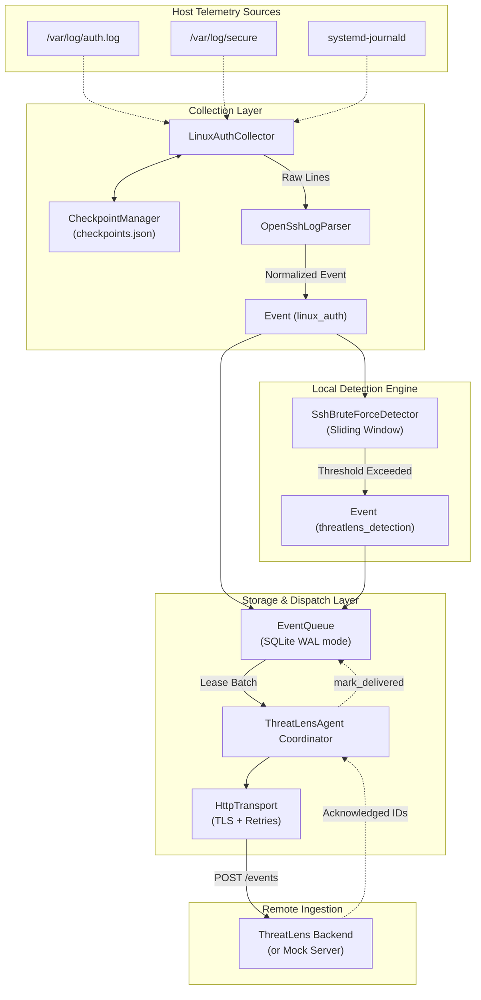
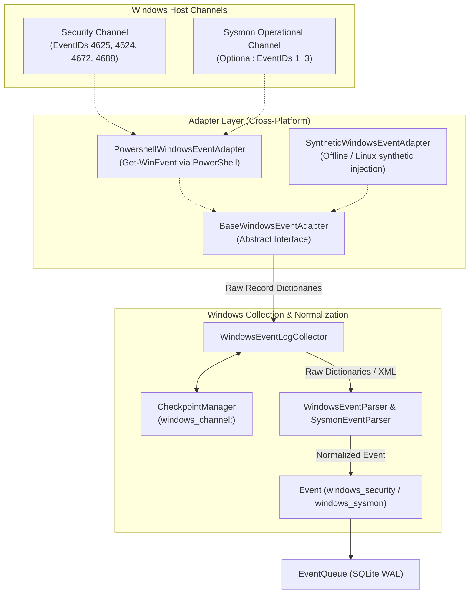

# ThreatLens Endpoint Agent — Architecture Specification

This document details the software architecture, data flow, storage guarantees, and extensibility model of the **ThreatLens Endpoint Agent**.

---

## 1. Subsystem Responsibilities

```text
┌────────────────────────────────────────────────────────────────────────┐
│                        ThreatLens Endpoint Agent                       │
├─────────────────┬───────────────────────┬──────────────────────────────┤
│ Subsystem       │ Module                │ Primary Responsibility       │
├─────────────────┼───────────────────────┼──────────────────────────────┤
│ CLI             │ cli.py                │ Commands, collection trigger │
│ Coordinator     │ agent.py              │ Lifecycle, pipeline dispatch │
│ Configuration   │ config.py             │ Validated YAML/env loading   │
│ Models          │ models/events.py      │ Unified schema & validation  │
│                 │ models/device.py      │ Stable host identity metadata│
│ Storage         │ storage/state.py      │ Atomic state & permissions   │
│                 │ storage/queue.py      │ Durable SQLite event buffer  │
│                 │ storage/checkpoint.py │ Checkpoints & rotation track │
│ Collectors      │ collectors/base.py    │ Abstract collector interface │
│                 │ collectors/linux_auth │ Linux auth.log/journald tail │
│                 │ collectors/windows_evt│ Windows Event Log collector  │
│                 │ collectors/windows_adp│ PowerShell/Synthetic adapters│
│                 │ collectors/parsers/ssh│ OpenSSH log normalization    │
│                 │ collectors/parsers/win│ Windows/Sysmon normalization │
│ Detection       │ detection/base.py     │ Abstract detection interface │
│                 │ detection/ssh_brutefor│ Sliding-window SSH detector  │
│ Transport       │ transport/base.py     │ Abstract transport contract  │
│                 │ transport/http.py     │ HTTPS with retries & jitter  │
│                 │ transport/mock.py     │ Local mock test server       │
└─────────────────┴───────────────────────┴──────────────────────────────┘
```

---

## 2. Event Flow & Telemetry Pipeline



1. **Discovery & Tailing**: `LinuxAuthCollector` probes `/var/log/auth.log`, `/var/log/secure`, and `journalctl`. `CheckpointManager` inspects file inodes and offsets, detecting log rotation and truncation.
2. **Normalization & Sanitization**: `OpenSshLogParser` extracts timestamps, source IPs (IPv4/IPv6), usernames, ports, authentication methods, and failure reasons, outputting standardized `Event` models. Passwords are automatically redacted.
3. **Local Detection**: Newly collected events pass to `SshBruteForceDetector`. Attempts are tracked per `(source_ip, target_host)` within a sliding time window (default 120s). Paired invalid-user logs are coalesced into a single attempt.
4. **Local Buffering**: Both telemetry events and detection alert events are enqueued into `events_queue.db`.
5. **Durable Dispatch**: When `flush()` executes, in-flight batches are sent via `HttpTransport`. Events are purged or retained upon receiving verified HTTP 2xx server acknowledgments.

### Windows Telemetry Pipeline



1. **Adapter Isolation**: All Windows event queries execute through `BaseWindowsEventAdapter`. `PowershellWindowsEventAdapter` wraps PowerShell `Get-WinEvent` with XPath filters, while `SyntheticWindowsEventAdapter` allows comprehensive test execution on Linux without requiring a Windows host.
2. **Record ID Checkpointing**: Monotonic 64-bit `EventRecordID`s are persisted in `checkpoints.json`. If a log clear is detected (current channel records have IDs less than the checkpoint), the checkpoint is safely reset and collection resumes from record 1.
3. **Event Normalization**: `WindowsEventParser` normalizes Event IDs 4625 (Logon Failure), 4624 (Logon Success), 4672 (Special Privilege Assigned), and 4688 (Process Creation). `SysmonEventParser` provides an optional extension point for Sysmon Event IDs 1 and 3.
4. **Command-Line Privacy**: To protect credentials passed in process invocations, `CommandLine` arguments in process creation events are excluded by default (`include_command_line: false`).

---

## 3. Why a Common Event Schema is Necessary

Operating systems record security activity in fundamentally disparate formats:
- **Linux** uses `syslog` lines (`/var/log/auth.log`, `secure`), systemd `journald` JSON entries, and `auditd` key-value audit records (`type=USER_LOGIN`, `type=EXECVE`).
- **Windows** uses the Windows Event Log system (`EvtSubscribe`, XML/binary EVTX formats) with numerical Event IDs (e.g., `4624` for successful logon, `4625` for logon failure).

The ThreatLens Common Event Schema (v1.0.0) normalizes cross-platform telemetry into a consistent format:
- Consistent timestamp format in ISO-8601 UTC with explicit timezone offsets.
- Normalized severity levels (`informational`, `low`, `medium`, `high`, `critical`).
- Normalized network indicators (`source_ip`) and identity anchors (`username`).
- Preserves raw event text for forensic non-repudiation while stripping passwords.

---

## 4. Durable SQLite Queue: Resilient Local Buffering

The durable local queue guarantees:
- **Zero In-Memory Volatility**: Events are written directly to SQLite with WAL mode (`PRAGMA journal_mode = WAL;`) and synchronous writes before being acknowledged.
- **Restart Resilience**: If the agent process or host system is terminated abruptly, events in flight remain stored in the SQLite database and are automatically reset to `pending` upon next startup.
- **Concurrency & Corruption Protection**: All database transactions are serialized using thread-safe locking and standard SQLite busy timeouts.
- **Configurable Limits**: Storage limits (`max_events`, `max_disk_mb`) prevent the queue from consuming unbounded disk space. When storage is constrained, delivered events are pruned first.

---

## 5. Event Schema Specification (v1.0.0)

| Field | Type | Required | Description |
| :--- | :--- | :--- | :--- |
| `schema_version` | String | Yes | Version of event schema (e.g., `"1.0.0"`) |
| `event_id` | String (UUIDv4) | Yes | Globally unique event identifier |
| `device_id` | String (UUIDv4) | Yes | Stable agent device identity |
| `timestamp` | String (ISO-8601) | Yes | UTC timestamp with timezone offset (`Z` or `+00:00`) |
| `source` | String | Yes | Telemetry provider (`"linux_auth"`, `"threatlens_detection"`) |
| `event_type` | String | Yes | Category (`"ssh_auth_failure"`, `"potential_ssh_bruteforce"`) |
| `severity` | String (Enum) | Yes | `"informational"`, `"low"`, `"medium"`, `"high"`, `"critical"` |
| `source_ip` | String (IP) | No | Client or remote IPv4/IPv6 address |
| `username` | String | No | Target or originating user account |
| `raw_event` | String | No | Sanitized raw log line or detection explanation |
| `attributes` | Object (JSON) | Yes | Platform-specific key-value telemetry attributes |
